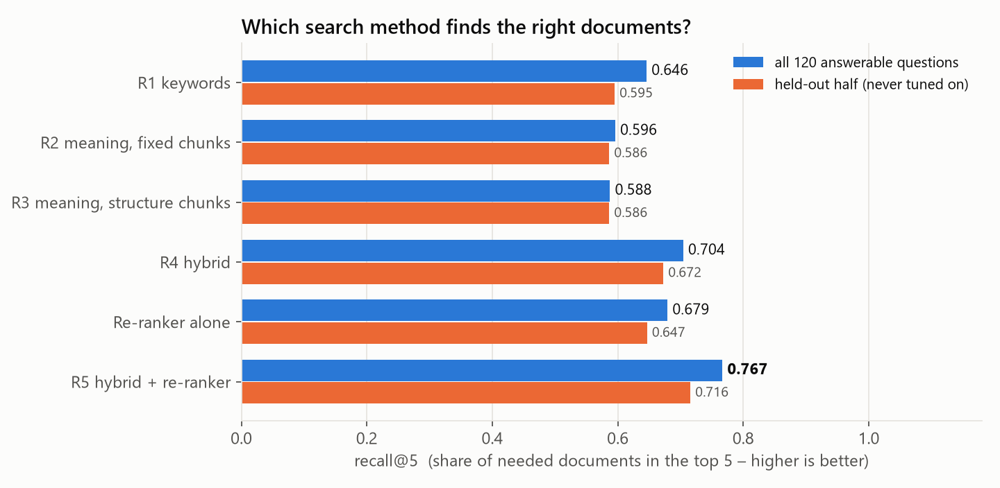
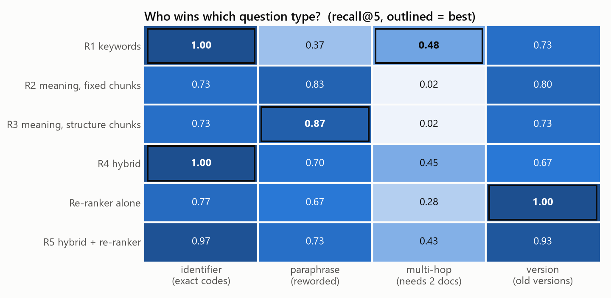
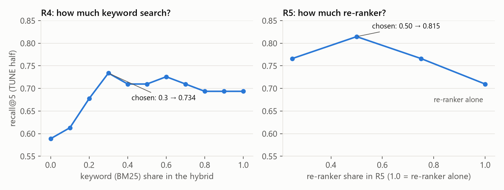
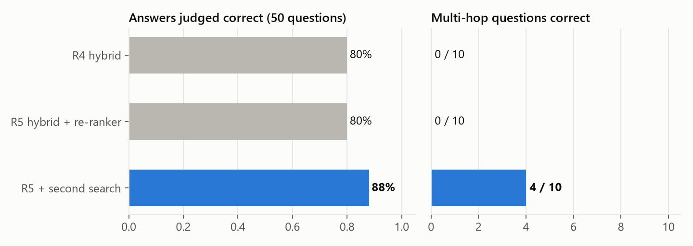

# Task 3 – RAG under the microscope: our results

> **In one sentence:** we compared five ways to *find* the right documentation pages for a question; a mix of
> keyword search and meaning search, double-checked by a re-ranker, finds the most (**recall@5 0.767**), and with a
> second search for multi-step questions it answers **88 %** of the judged questions correctly – without ever making
> something up.

The task description and data formats are in [README.md](README.md) (given). Every number here comes from the files in
`results/` and can be reproduced (commands at the end). The charts are drawn from those files by `make_figures.py`.

| ✅ What the lab sheet asks for | Where in this file |
|---|---|
| R1–R5 implemented | [§2](#2-our-five-search-methods) |
| per-category table, chunk-size comparison | [§3](#3-results-which-method-finds-the-right-documents), [§4](#4-chunk-size) |
| end-to-end answers + judge, 10 judge decisions checked by hand | [§6](#6-from-search-to-answers), [§7](#7-can-we-trust-the-judge) |
| cost and latency | [§8](#8-cost-and-speed) |
| failure analysis (5 questions) | [§9](#9-failure-analysis-5-questions-our-best-system-gets-wrong) |
| recommendation | [§10](#10-recommendation) |
| test predictions | [§11](#11-test-predictions) |

---

## 1. The task in one picture

| | |
|---|---|
| 📚 **Documents** | **932** pages about "PaderQueue", a fictional message queue: config pages (170), error codes (77), command line (36), release notes (14), incident reports (120), forum posts (500 – can be wrong!), runbooks (15) |
| ❓ **Practice questions** | **150** with the correct answer and the pages that contain it – **30 per category** |
| 🧪 **Test questions** | **100** without answers – we hand in predictions |

The five question categories, with a real example each:

| Category | Example question | What makes it hard |
|---|---|---|
| **identifier** | "In PaderQueue 4.x, what does `metrics.interval_s` default to?" | an exact name or code must be matched |
| **paraphrase** | "…the part that holds back messages until a later point in time has too many waiting jobs… What is the name of this error?" | different words than the documentation (answer: the *scheduler* error PQ-E3246) |
| **multi-hop** | "Which permanent fix does the documentation recommend for the error that caused incident INC-2024-183?" | needs **two** pages: the incident report names the error, the error page has the fix |
| **version** | "What was the default value of `ingress.interval_s` in PaderQueue **2.x**?" | the 2.x and 4.x pages are almost identical |
| **unanswerable** | "What is the default value of `spool.queue_capacity`?" | the answer is not in the documentation – the system must say so |

**How we measure search quality:** **recall@5** = share of the needed pages that are among the top 5 results
(1.0 = always found). **precision@5** = are they near the top. Both from the given `evaluate.py`.

**Fair testing:** the 150 questions are split by id into **TUNE** (odd) and **HOLDOUT** (even). Every setting was chosen
on TUNE only; we report all questions *and* HOLDOUT alone – like practising with one exam and being tested with another.

---

## 2. Our five search methods

| | Method | In simple words | Code |
|---|---|---|---|
| **R1** | BM25 keyword search (on the same chunks as R3) | Ctrl+F that knows rare words matter | `retrievers.py: BM25Retriever` |
| **R2** | fixed-size chunks (128 tokens, 32 overlap) + embeddings | "meaning" search, text cut every 128 tokens like a ruler | `chunking.py: fixed_chunks` |
| **R3** | recursive chunks (headings → paragraphs → lines → sentences, up to 128 tokens) + embeddings | "meaning" search, text cut along its structure | `chunking.py: recursive_chunks` |
| **R4** | hybrid: **0.3 × BM25 + 0.7 × cosine**, both scaled to 0–1 | ask both, combine the votes | `retrievers.py: HybridRetriever` |
| **R5** | R4 + **re-ranking** of the top 30 with `cross-encoder/ms-marco-MiniLM-L-6-v2`, blended **0.5 × re-ranker + 0.5 × hybrid** | a second model reads question + page together and double-checks | `retrievers.py: RerankRetriever` |

Design choices that matter:
- **A label on every chunk:** `[config | ingress.interval_s (PaderQueue 2.x) | version 2.x]` – type, title and version are searchable and visible to the answer model.
- **Identifiers in BM25:** `PQ-E4663` is kept whole **and** split (`pq-e4663`, `pq`, `e4663`), so an exact code scores very high.
- **Scaling before mixing:** BM25 scores go up to ~30, cosine stays below 1 – without min-max scaling, BM25 would always win.
- **Embeddings:** `kiconnect.qwen3-embedding-8b` (gateway, 4,096 numbers per text), cached in `.cache/` (140 MB, not submitted).
- **Answer model:** `openai.gpt-6-luna` gets the top 8 chunks (≈ 900 tokens) and must answer only from them, trust official pages over forum posts, respect versions – or say exactly *"The documentation does not contain this information."*

---

## 3. Results: which method finds the right documents?



> 🏆 **R5 is best: 0.767** (0.716 on the held-out half) · R4 hybrid 0.704 · R1 keywords 0.646 · meaning search alone ≈ 0.59
> ⚠️ The **re-ranker alone** (0.679) is *worse* than the hybrid without it – only the 50/50 blend helps.
> ✅ Same ranking on the held-out half → the settings were not just fitted to the questions we report.

### Who wins which kind of question?



| Category | Winner | Why |
|---|---|---|
| **identifier** | 🟩 keywords **1.00** (meaning search 0.73) | a code like `PQ-E3441` is a rare token – decisive for BM25, while for embeddings all error codes look alike |
| **paraphrase** | 🟩 meaning search **0.87** (keywords 0.37) | "holds back messages until later" shares no words with "scheduler", but means the same |
| **multi-hop** | nobody (best 0.48) | the second page is never named in the question – one search can't find it (→ §6) |
| **version** | 🟩 re-ranker **1.00** | it reads question and page *together* and notices "2.x" in both |

<details><summary>Full table with precision@5 (all 120 answerable questions)</summary>

recall@5 / precision@5

| config | identifier | paraphrase | multi-hop | version | overall |
|---|---|---|---|---|---|
| R1 BM25 | 1.00 / 0.78 | 0.37 / 0.25 | 0.48 / 0.78 | 0.73 / 0.65 | 0.646 / 0.614 |
| R2 fixed + dense | 0.73 / 0.62 | 0.83 / 0.74 | 0.02 / 0.01 | 0.80 / 0.64 | 0.596 / 0.505 |
| R3 recursive + dense | 0.73 / 0.64 | 0.87 / 0.76 | 0.02 / 0.02 | 0.73 / 0.63 | 0.588 / 0.512 |
| R4 hybrid | 1.00 / 0.76 | 0.70 / 0.64 | 0.45 / 0.79 | 0.67 / 0.61 | 0.704 / 0.701 |
| R5 pure re-ranking | 0.77 / 0.64 | 0.67 / 0.51 | 0.28 / 0.36 | 1.00 / 0.93 | 0.679 / 0.611 |
| **R5 (blend 0.5)** | 0.97 / 0.76 | 0.73 / 0.64 | 0.43 / 0.73 | 0.93 / 0.65 | **0.767** / 0.697 |

HOLDOUT only: R1 0.595 · R2 0.586 · R3 0.586 · R4 0.672 · R5 pure 0.647 · **R5 0.716**. All tables: `results/retrieval_tables.md`.
</details>

---

## 4. Chunk size

| R3 chunk size (overlap 0) | chunks | avg. tokens | recall@5 | precision@5 |
|---|---|---|---|---|
| 64 | 2,803 | 60 | 0.600 | 0.493 |
| **128** (chosen on TUNE) | 1,315 | 109 | 0.588 | **0.512** |
| 256 | 957 | 144 | 0.588 | 0.502 |

> **Chunk size hardly matters here**, because most pages are only 100–190 tokens – they fit into one chunk anyway.
> 64 tokens helps version questions a little (the "Default" row of a config page becomes its own chunk), but more
> fragments of the same page crowd the top 5 (lower precision).

---

## 5. How we chose the two settings



- **R4 keyword share 0.3:** best recall on TUNE. A small share is enough: after scaling, an exact identifier match gets the full 1.0 from BM25.
- **R5 re-ranker share 0.5:** best on TUNE (0.815); at 1.0 (re-ranker alone) it drops to 0.710.

---

## 6. From search to answers



The two best search methods (R4, R5) answered the same 50 practice questions (`judge.py --sample 50`):

| system | identifier | paraphrase | version | unanswerable | multi-hop | **correct** | faithful |
|---|---|---|---|---|---|---|---|
| R4 | 1.00 | 1.00 | 1.00 | 1.00 | 🟥 0.00 | 0.80 | 0.98 |
| R5 | 1.00 | 1.00 | 1.00 | 1.00 | 🟥 0.00 | 0.80 | 1.00 |
| **R5 + second search** | 1.00 | 1.00 | 1.00 | 1.00 | 🟩 **0.40** | 🏆 **0.88** | **1.00** |

### The multi-hop problem and our fix

| step | page needed | found by one search? |
|---|---|---|
| 1 | incident report INC-2024-183 → *"caused by **PQ-E4663**"* | ✅ the question names it |
| 2 | error page PQ-E4663 → the fix | ❌ the question never says "PQ-E4663" |

**Second search (extension):** after the first search, take the codes and setting names found in the top pages
(e.g. `PQ-E4663`) and search for each of them; add those chunks to the answer model's context.
(Taking the codes from the *whole page*, not only the retrieved chunk, mattered: incident reports are split into two
chunks, and "caused by …" is often in the other one – this raised multi-hop from 0.25 to 0.40.)

| multi-hop check | R5 | R5 + second search |
|---|---|---|
| judged questions answered correctly | 0 / 10 | **4 / 10** |
| **20 questions we never looked at** – both pages in the context | 0 / 20 | **7 / 20** |

> ✅ It also works on questions we didn't use to design it → not overfitted.
> The ranked list for recall@5 and the test predictions stays plain R5 (mixing the follow-ups into the top 5 helped
> multi-hop, 0.43 → 0.55, but hurt overall, 0.767 → 0.688).

---

## 7. Can we trust the judge?

We checked **10 judge decisions by hand** (2 per category, deployed system):

| id | category | answer (short) | judge | we agree? |
|---|---|---|---|---|
| dev004 | paraphrase | `dlq.max_retries` | correct | ✅ |
| dev011 | paraphrase | `broker.timeout_ms` | correct | ✅ |
| dev008 | identifier | defaults to `10` seconds | correct | ✅ (unit added, but it's in the docs) |
| dev061 | identifier | name of the tenant the command applies to | correct | ✅ |
| dev009 | version | `none` in 2.x | correct | ✅ |
| dev033 | version | `60` seconds in 3.x | correct | ✅ |
| dev013 | unanswerable | "not in the documentation" | correct | ✅ |
| dev054 | unanswerable | "not in the documentation" | correct | ✅ |
| dev025 | multi-hop | "not in the documentation" | wrong | ✅ the fix *is* documented |
| dev030 | multi-hop | "not in the documentation" | wrong | ✅ |

> ✅ **Correctness: trusted** – we agree 10 / 10.
> ⚠️ **Answer relevance: not trusted** – honest "not in the documentation" answers get only **≈ 0.40** (single answers
> 0.32–0.55) vs **0.70–0.79** for normal answers: the judge invents the same three generic questions for that sentence
> (identical prompt → the gateway cache even returns the identical reply). Short correct answers also score lower than
> wordy ones (dev061: 0.65).

---

## 8. Cost and speed

| | build the index (first time) | search per question | tokens per question |
|---|---|---|---|
| R1 keywords | 0.2 s | **1.3 ms** | 0 (runs locally) |
| R2 / R3 meaning | 65 s / 100 s embedding | 0.5 ms + **0.26 s** query embedding | ≈ 42 (embedding, free) |
| R4 hybrid | both | **3.3 ms** + 0.26 s | ≈ 42 |
| R5 + re-ranker | + 27 s to load the model | 🐢 **620 ms** + 0.26 s (30 pairs on a laptop CPU) | ≈ 42 + 30 local pairs |
| R5 + second search | same | ≈ 1.5 s (up to 4 more searches) | ≈ 200 |

**Answers:** ≈ 1,150 prompt tokens (R4/R5) or ≈ 1,490 (second search) + ≈ 40 output tokens, ≈ 2.5 s each.
**Money:** embeddings are free; 50 answers ≈ $0.008, judging 50 answers ≈ $0.01, the 100 test predictions $0.021.
None of the 300 answer calls was a gateway cache hit (`cache_hit` in `logs/generate_*.jsonl`) → real first-time latencies.

---

## 9. Failure analysis: 5 questions our best system gets wrong

> All wrong answers are **search (retrieval) failures**. The answer model never invented a fact (faithfulness 1.0):
> whenever the fact was missing, it said so.

| id | question (short) | what was in the context | failure | why |
|---|---|---|---|---|
| dev025 | fix for the error behind INC-2024-171 | the incident (names PQ-E1915) + forum thread "PQ-E1915 after upgrade?" | 🔎 retrieval (2nd hop) | the follow-up search for `PQ-E1915` finds the forum thread first; it fills both slots, the error page never gets in |
| dev030 | fix for the error behind INC-2025-175 | the incident (names PQ-E2617) + forum "PQ-E2617 after upgrade?" | 🔎 retrieval (2nd hop) | same: forum threads titled with the code outrank the official page |
| dev042 | current default of the setting PQ-E2051 says to change | six forum threads, no error page | 🔎 retrieval (1st hop) | the official page `PQ-E2051` isn't even in the first round – forum threads with the code in the title win |
| dev069 | current default of the setting PQ-E4020 says to change | the error page **and** the `spool.compression` page – but the **2.x** one | 🔎 retrieval (version) | the follow-up query has no version, so the 2.x page beat the 4.x page; the model rightly refused to call a 2.x value "current" |
| dev083 | fix for the error behind INC-2024-147 | the incident (names PQ-E2051) + its forum thread | 🔎 retrieval (2nd hop) | same as dev025 |

**What would fix it:** prefer official pages over forum threads when they match equally; take more follow-up chunks
per code; add "4.x" to follow-up searches when the question asks for the *current* value.

---

## 10. Recommendation

> 🏆 **Deploy R5 + second search:** hybrid (0.3 keywords + 0.7 meaning) on 128-token structure chunks, re-ranker
> blended 50/50, plus follow-up searches for codes found in the first results.
> → best search (recall@5 **0.767**, held-out **0.716**) and best answers (**88 %** correct, never invents).
>
> ⚡ **If speed matters more: R4** – 3 ms instead of 620 ms per search, no 27 s model load, same correctness as R5
> without the second search (80 %). On a GPU or with a smaller shortlist the re-ranker would be cheap.

Next steps, most valuable first: official-over-forum preference in the follow-up search · version-aware follow-ups ·
a re-ranker that understands codes (or skip re-ranking when the question contains an exact code).

---

## 11. Test predictions

`predictions_test.jsonl`: 100 lines `{id, answer, retrieved_doc_ids}` (5 pages each) from the deployed system.
36 of 100 answers are "not in the documentation" (practice sample: 32 %).

---

## A bug we found on the way

The first results said 256-token chunks were terrible (**recall 0.19**). That made no sense – most pages fit into one
chunk anyway. The cause: when an embedding batch mixed texts the gateway had **cached** with new ones, the gateway
returned the vectors **in the wrong order** (even the `index` field was wrong: `[0, 1, 1, 3, 2, 5]`). Our four
chunkings share many identical chunks, so this happened constantly. Fix in `common/llm_client.py`: embedding requests
bypass the gateway cache. Afterwards 256-token chunks scored 0.588, like the others; Task 2's vectors were checked and correct.

---

## How to run

From the repository root (gateway key in `.env`, university network or VPN; R5 needs `uv sync --extra local`):

```bash
uv run python task3_rag/chunking.py                                   # chunk statistics
uv run python task3_rag/run_retrieval.py                              # R1–R5, chunk sizes, tuning -> results/
uv run python task3_rag/evaluate.py task3_rag/results/retrieval_R5_dev.jsonl --k 5
uv run python task3_rag/generate.py --system R5 --two-hop --split dev --sample 50   # results/answers_R5_2hop.jsonl
uv run python task3_rag/judge.py task3_rag/results/answers_R5_2hop.jsonl --sample 50 --out task3_rag/results/judge_R5_2hop.jsonl
uv run python task3_rag/generate.py --system R5 --two-hop --split test           # predictions_test.jsonl
uv run --with matplotlib python task3_rag/make_figures.py             # the charts in results/figures/
```

The first run embeds the corpus four times (≈ 5 minutes); later runs use the cache.

| file | content |
|---|---|
| `chunking.py` | fixed-size and recursive chunking, the label on every chunk |
| `retrievers.py` | BM25 tokenizer, BM25 / dense / hybrid / re-ranking retrievers, embedding cache |
| `run_retrieval.py` | builds and evaluates everything, TUNE/HOLDOUT split, writes `results/` |
| `generate.py` | answers (with or without the second search) and the test predictions |
| `make_figures.py` | the four charts in `results/figures/` |
| `results/retrieval_*_dev.jsonl`, `metrics_*.json` | retrieval results and `evaluate.py` output per method |
| `results/retrieval_report.json`, `retrieval_tables.md` | all tables, tuning grids, timings |
| `results/answers_*.jsonl`, `judge_*.jsonl`, `judge_summary_*.txt` | generated answers and judge results |
| `results/two_hop_context_check.json` | the check on unseen multi-hop questions |
| `logs/` | every gateway call (generation, judge) |
